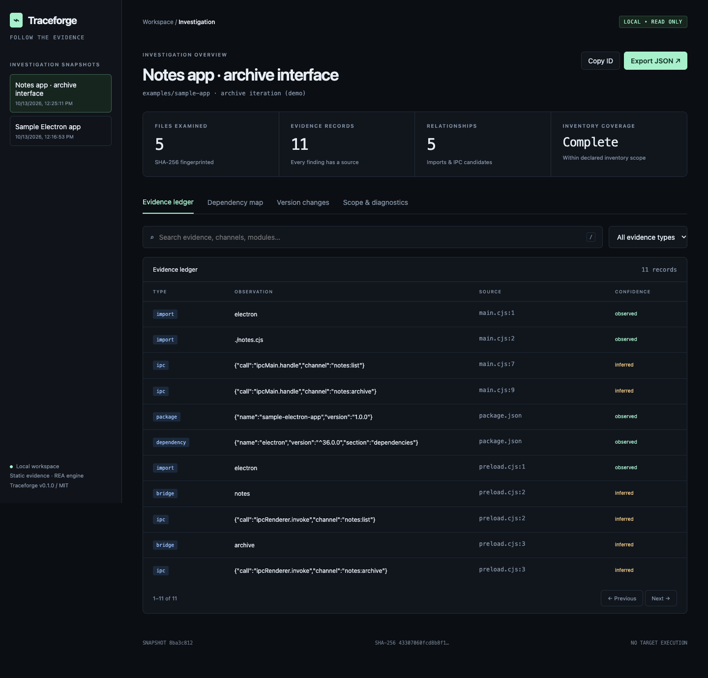

<div align="center">

# Traceforge

**Follow the evidence. Build with confidence.**

A local reverse-engineering workbench with an evidence ledger, version diffs, dependency maps, reconstruction briefs, and the REA analysis engine.

[](https://github.com/Alps-is-Core/traceforge/actions/workflows/ci.yml)
[](LICENSE)
[](package.json)

</div>



Traceforge is inspired by [REA](https://github.com/morluto/rea), and uses its pinned MIT-licensed engine instead of pretending to have independently rebuilt every decompiler integration. Traceforge adds a persistent investigation workspace around that engine: capture evidence, compare versions, trace static relationships, and hand findings to another developer or agent.

## Quick start

Requires Node.js 22.19+ and npm. The pinned REA engine supports Node 22.x ≥22.19, 24.x ≥24.11, or 26+; use one of those supported lines.

```bash
git clone https://github.com/Alps-is-Core/traceforge.git
cd traceforge
npm ci
npm run demo
npm run demo:ui
```

Open the loopback URL printed by the dashboard, normally `http://127.0.0.1:4318`. No account, API key, or cloud upload is required for the workspace analyzer. The demo fixture is inspected, never executed.

For your own target:

```bash
node src/cli.js inspect /path/to/app --label "Baseline"
node src/cli.js list
node src/cli.js dashboard
```

To use the `traceforge` command, run `npm link` from this checkout, or install the `.tgz` from the GitHub release. This project is not published to the npm registry.

## What Traceforge adds

| Capability                       | What it does                                                                                                                                    |
| -------------------------------- | ----------------------------------------------------------------------------------------------------------------------------------------------- |
| Immutable snapshots              | Saves each inspection with a UUID, timestamps, file hashes and an inventory fingerprint.                                                        |
| Evidence ledger                  | Searches and pages observations with source paths, hashes, line/column or byte-offset references.                                               |
| JavaScript / TypeScript analysis | Parses imports, exports, static IPC channels, context bridges, route candidates and fetch candidates using Babel ASTs.                          |
| Dependency & IPC map             | Resolves direct relative file imports and records external/unresolved imports; matching IPC channel names remain inferred candidates.           |
| Version comparisons              | Diffs file content hashes and semantic findings; line movement alone does not count as a changed finding.                                       |
| HAR inspection                   | Summarizes recorded requests, statuses, MIME types and durations while omitting headers, payloads, URL credentials, query values and fragments. |
| Lightweight binary inspection    | Reads ELF/PE/WASM headers, Mach-O signature candidates and bounded ASCII strings at original byte offsets.                                      |
| Reconstruction briefs            | Produces evidence-linked Markdown handoffs with interface candidates, dependency declarations, open questions and a verification checklist.     |
| Interactive HTML reports         | Self-contained, searchable reports with graph, comparison and coverage views; work offline with no CDN or external script requests.             |
| Agent interface                  | Nine MCP tools share the same workspace workflows as the CLI. Discover and call REA tools through a lazy stdio bridge.                          |
| Full REA CLI access              | `traceforge engine ...` forwards arguments and output to pinned REA 6.4.0, preserving upstream capabilities and setup behavior.                 |

## A complete investigation

```bash
traceforge inspect ./app-v1 --label "Before" --json
traceforge inspect ./app-v2 --label "After" --json
traceforge diff BEFORE_UUID AFTER_UUID
traceforge search AFTER_UUID "clipboard" --kind ipc --limit 50
traceforge graph AFTER_UUID --output graph.json
traceforge report AFTER_UUID --history --output investigation.html
traceforge brief AFTER_UUID --output implementation-brief.md
```

Use the IDs printed by `inspect` or `list`. Select the same `--workspace /path/to/evidence` on each command when sharing evidence between CLI and agents. The dashboard is read-only; reload after capturing another snapshot. By default reports contain the selected snapshot. Add `--history` to include workspace snapshots and enable offline comparison; the dashboard includes workspace history.

## Deep analysis with REA

```bash
traceforge engine --help
traceforge engine doctor
traceforge engine analyze-javascript-application /absolute/path/to/app --json
```

REA supplies the broader native, Electron/ASAR, managed-code, Android, browser, archive, recorded-capture and runtime workflows. Some require external providers, platform-specific tooling, or runtime access. Consult [REA's documentation](https://github.com/morluto/rea#documentation) for exact prerequisites and effects.

Traceforge workspace inspection is static. Forwarded engine operations retain their own effects: runtime capture may launch a target, and setup may write agent configuration after its upstream approval step. Engine output is separate from Traceforge snapshots; it is **not automatically imported into the workspace**. Native provider behavior has not been independently verified by this project.

## MCP configuration

Configure your MCP client with an absolute checkout path and workspace path:

```json
{
  "mcpServers": {
    "traceforge": {
      "command": "node",
      "args": [
        "/absolute/path/to/traceforge/src/cli.js",
        "mcp",
        "--workspace",
        "/absolute/path/to/evidence"
      ]
    }
  }
}
```

Workspace tools: `traceforge_inspect`, `traceforge_list_snapshots`, `traceforge_search_evidence`, `traceforge_compare`, `traceforge_graph`, `traceforge_export_report`, and `traceforge_reconstruction_brief`.

Engine tools: `rea_list_tools` discovers exact input schemas with query/pagination; `rea_call_tool` invokes the selected tool. The engine starts on first use and stays alive for the MCP session. Engine calls are conservatively advertised as potentially destructive/open-world because effects vary by tool. Configure MCP access only for clients you trust to read local files and invoke the selected engine tools.

## Evidence boundaries

- No target code is executed by `inspect`. Files are read, hashed and parsed; snapshots are written only to the selected workspace.
- Observed syntax, derived relationships and inferred behavior stay distinct. Aliases, computed strings, bundler-specific resolution, runtime data shapes and business behavior are not established by this analyzer.
- Scans skip symlinks, `node_modules`, VCS trees, coverage outputs and the selected workspace. Exclusions are explicit; symlinks and parse/read failures make coverage partial.
- Default bounds: 10,000 files, 4 MiB per file, 128 MiB total bytes, 50,000 findings and 10,000 graph edges. ASCII extraction is capped at 500 strings per file and 512 bytes per string. Reaching a limit is reported. Workspace history reads are bounded at 1,000 snapshots and 128 MiB of serialized data; split or archive larger investigations.
- A missing file or finding in a partial scan does not prove deletion or absence. File changes during an inspection are diagnosed when detected; snapshots are not transactional filesystem captures.
- Reports may expose target paths, package metadata and extracted strings. HAR omission is format-specific; other extracted data is not automatically secret-redacted.
- HTML data is escaped, dynamic text is escaped, and a restrictive Content Security Policy blocks network access and unapproved scripts. The dashboard binds only to IPv4 loopback and validates Host/Origin.

See [architecture](docs/architecture.md), [design decisions](docs/design.md), [verification](docs/verification.md), and [contributing](CONTRIBUTING.md).

## Development

```bash
npm ci
npm run check
npm test
# Uses installed Google Chrome on macOS; otherwise an installed Playwright Chromium.
npm exec -- playwright-core install chromium
npm run test:browser
```

Set `TRACEFORGE_CHROME` to an explicit Chrome/Chromium executable when needed. CI installs Chromium and runs browser verification separately from the core and real MCP tests. There is no build step: shipped ESM source is the runtime.

## Credits and license

Traceforge code is MIT licensed, Copyright © 2026 Alps-is-Core. [REA](https://github.com/morluto/rea) by morluto inspired this project and powers its deep-analysis engine. This is an independent project, not an official REA distribution. See [third-party notices](THIRD_PARTY_NOTICES.md) and the retained [REA license](licenses/REA-MIT.txt).
