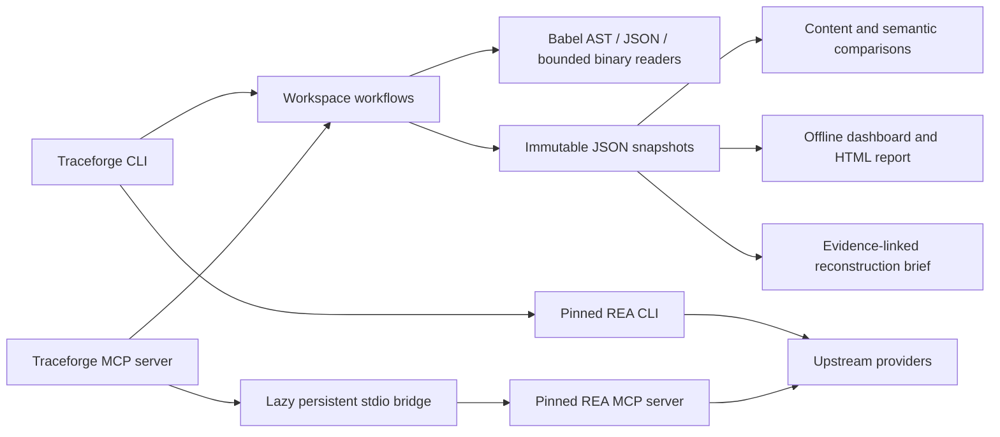

# Architecture

`src/core.js` owns target traversal, resource budgets, evidence storage, snapshot validation, searching and comparisons. `src/analyzers.js` owns format interpretation and graph derivation. CLI and MCP adapters call the same functions.

The REA engine is a direct, pinned dependency. The CLI forwards arguments with `spawn`, without a shell. MCP uses the standard protocol to discover and invoke tools. Client state is retained so upstream session semantics work across calls, and upstream child transport is closed with the Traceforge session. Workspace tools do not start the engine. Discovery returns input schemas and annotations without the much larger output-schema catalog.

Snapshots use schemaVersion 1, UUID filenames, restrictive filesystem modes where supported, and exclusive creation. Every finding references original source bytes by SHA-256 plus a source location. Content fingerprints use a sorted inventory of relative path/hash pairs. Semantic comparisons use multisets of source-path/kind/value, allowing duplicate facts while ignoring line movement. Findings remain independently accessible with their full source locations.

Graph resolution handles literal relative imports with documented extension/index candidates. It is not a Node, TypeScript, bundler or package-exports resolver. IPC edges join matching named static channels and are explicitly inferred. External and unresolved imports remain visible. Fanout is capped and reported.

Reports embed escaped JSON and a hash-approved inline application script. The dashboard serves only GET / over 127.0.0.1 and never exposes a target-reading HTTP API. Only the CLI/MCP can capture targets. Browser exports contain local saved evidence and do not upload it.

Deep REA evidence and workspace snapshots intentionally have separate schemas in v0.1.0. There is no silent conversion, no claim of native-provider validation and no invented runtime observations.
